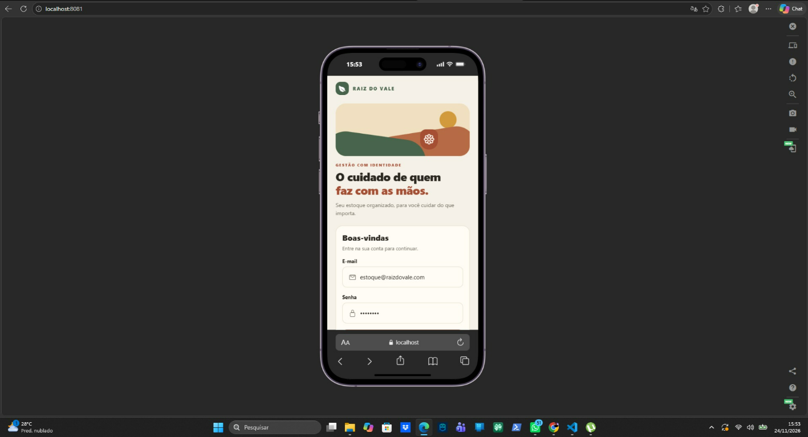
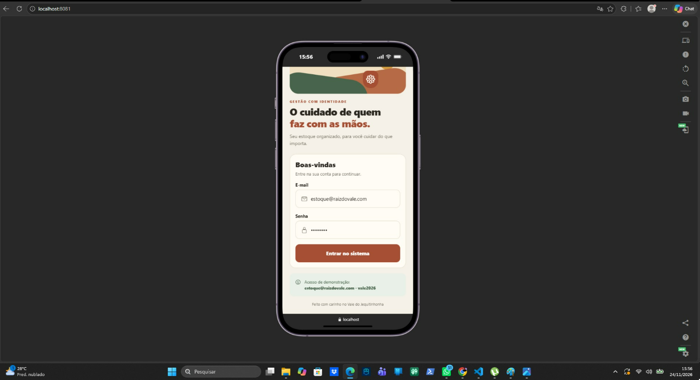
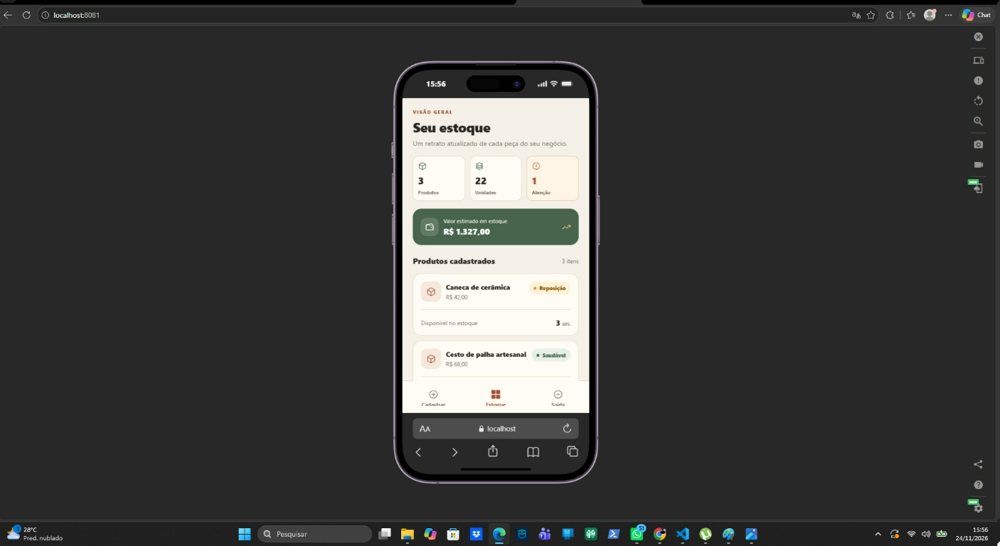
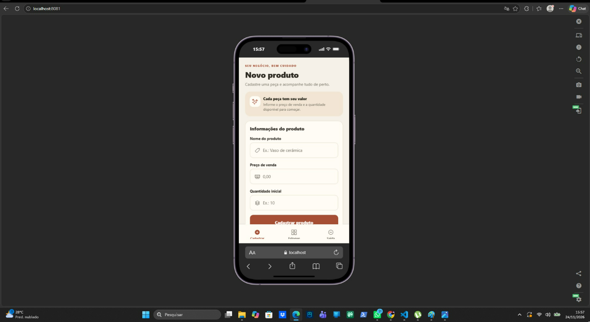
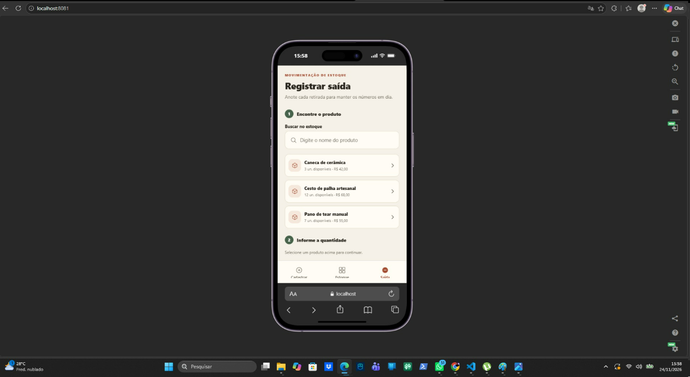
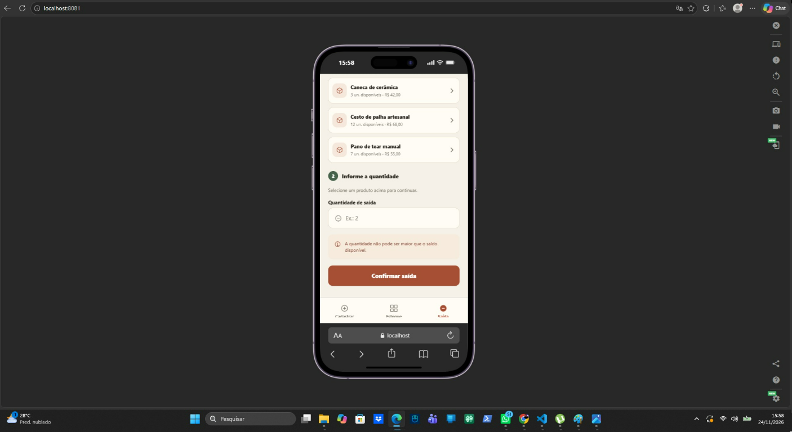
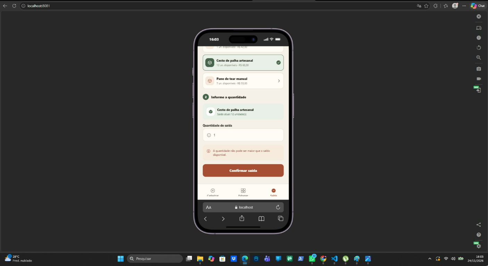
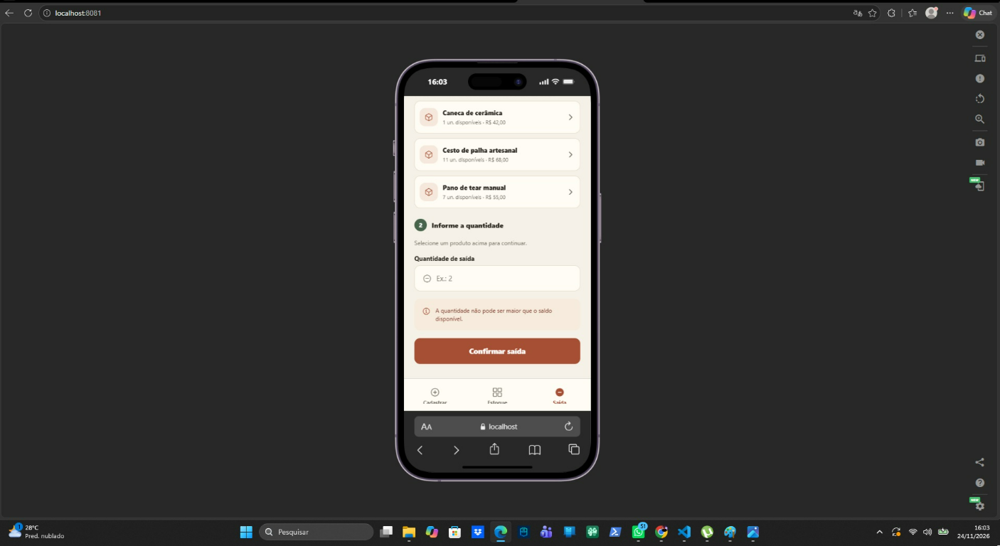

# Raiz do Vale

O **Raiz do Vale** é um aplicativo de gestão de estoque inspirado nas cores e no artesanato do Vale do Jequitinhonha. Desenvolvido como trabalho final da disciplina de Programação para Ambientes Móveis, ele ajuda pequenos negócios a cadastrar produtos, acompanhar quantidades disponíveis e registrar saídas.

## Funcionalidades

- **Login demonstrativo:** valida os campos de e-mail e senha e apresenta um indicador de carregamento antes de abrir o aplicativo.
- **Cadastro de produtos:** permite informar nome, preço de venda e quantidade inicial. Os produtos cadastrados aparecem nas demais telas.
- **Controle de estoque:** apresenta a lista de produtos, quantidades, valor estimado do estoque e indicadores de situação. Produtos com até 5 unidades recebem atenção para reposição; produtos com saldo zero aparecem como esgotados.
- **Saída de produtos:** permite buscar e selecionar um produto, informar a quantidade retirada e atualizar o saldo. O aplicativo não permite uma saída maior que a quantidade disponível.

O estoque é compartilhado entre as telas por meio da Context API. Os dados ficam **somente em memória**: ao reiniciar o aplicativo, as alterações são perdidas e os produtos de demonstração são restaurados. O login é simulado e não utiliza servidor ou autenticação real.

## Capturas de tela

As imagens abaixo mostram o aplicativo em uma visualização mobile no navegador.

### Login

Tela inicial e formulário de acesso de demonstração.

| Tela inicial | Formulário de login |
|:---:|:---:|
|  |  |

### Estoque e cadastro

O painel apresenta os produtos e o resumo do estoque. Na aba **Cadastrar**, é possível inserir um novo produto.

| Visão geral do estoque | Cadastro de produto |
|:---:|:---:|
|  |  |

### Saída de produtos

Na aba **Saída**, o usuário busca e seleciona um produto, informa a quantidade e confirma a retirada. A última imagem mostra a lista após o registro.

| Busca e seleção | Quantidade de saída |
|:---:|:---:|
|  |  |

| Produto selecionado | Após registrar a saída |
|:---:|:---:|
|  |  |

## Tecnologias

- **React Native e Expo:** desenvolvimento da interface mobile.
- **TypeScript:** tipagem de componentes, dados e navegação.
- **React Navigation:** navegação entre login e área principal, com Stack e abas inferiores.
- **Context API:** compartilhamento do estado do estoque em memória.
- **Expo Vector Icons:** ícones da interface.

## Como executar

É necessário ter o Node.js e o npm instalados.

1. No terminal, acesse a pasta do projeto e instale as dependências:

   ```bash
   npm install
   ```

2. Inicie o Expo:

   ```bash
   npx expo start
   ```

3. Para testar no celular, abra o **Expo Go** e escaneie o QR code exibido no terminal. Mantenha o celular e o computador na mesma rede Wi-Fi. Também é possível usar um emulador Android/iOS ou pressionar **w** no terminal para abrir a versão web.

### Acesso de demonstração

- **E-mail:** `estoque@raizdovale.com`
- **Senha:** `vale2026`

## Organização do projeto

```text
src/
├── components/  Componentes reutilizáveis
├── context/     Estado global do estoque
├── global/      Tema, tipos e formatação
├── pages/       Telas do aplicativo
└── routes/      Navegação Stack e Bottom Tabs
```

Os estilos das telas e dos componentes ficam em arquivos `styles.ts` separados dos respectivos arquivos `.tsx`.
